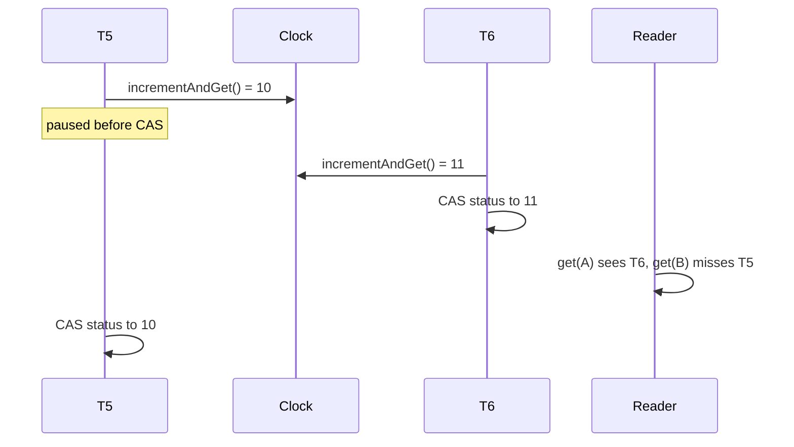

**Multi-version concurrency control (MVCC)** is how most databases let reads and writes run at the same time. An update doesn't overwrite a value. It adds a new version next to the old one, and each reader picks the version it is allowed to see. PostgreSQL keeps old row versions in the table itself, and its docs put the payoff plainly: reading never blocks writing, and writing never blocks reading<sup><a href="#ref-1">[1]</a></sup>. MySQL's InnoDB gets the same effect by rebuilding older versions from its undo log<sup><a href="#ref-2">[2]</a></sup>.

The alternative shows why this matters. A store that keeps one version per key has to hide a batch that updates A and B until the batch finishes. The simple way to do that is a lock, and then a `get` has to wait for any write in progress on the keys it reads. With versions, the batch writes its new values alongside the old ones, and readers keep seeing the old values until the batch commits.

To see how much of that holds up in code, I built a small in-process MVCC key-value store in Java: `put`, `get`, `delete`, per-key TTL, and an atomic `writeBatch` across keys. The goals were simple to state: a reader that calls `get(A)` and then `get(B)` must never see half of a batch, any sequence of reads must match some serial order of the commits, and readers should never block. On paper the design felt finished. Then I wrote it, and three parts turned out to be wrong in ways the whiteboard never showed.

None of the three was exotic. Each came from an assumption that sounds obviously true when you say it out loud: "a finished transaction committed", "a higher transaction id means a newer write", and "an older version is safe to delete once a newer one exists". This post walks through each one: the interleaving that breaks it, and what replaced it.

---

## The design on paper

The paper design had five parts, and each one looked self-evidently correct.

1. **Immutable versions.** A write never modifies an existing version. It appends a new version to that key's chain, a sorted map keyed by the id of the transaction that wrote it. A delete appends a tombstone.
2. **Transaction ids.** Every write, single-key or batch, gets an id from a global counter when it starts.
3. **A completed set.** When a transaction finishes writing all its versions, it adds its id to a concurrent set. A reader treats a version as visible only if its transaction is in that set, so one add makes a whole batch appear at once.
4. **A low watermark.** The set grows forever, so keep a number $W$ where every transaction at or below $W$ is known to be done. Versions at or below $W$ skip the set lookup, and the set only holds the in-flight window.
5. **Background cleanup.** Once a newer version of a key is committed, older versions are garbage. A reader scans a key's whole chain from oldest to newest and keeps the newest visible version. If cleanup deletes a version just ahead of the reader, a newer one is still further along, so the reader can't miss a value.

The happens-before story, which decides whether one thread's writes are visible to another, also checks out. A transaction inserts its versions into concurrent collections and then adds to the completed set. The `java.util.concurrent` docs guarantee that anything a thread did before inserting into a concurrent collection is visible to a thread that later reads that element<sup><a href="#ref-3">[3]</a></sup>. So a reader that finds transaction T7 in the completed set also sees every version T7 wrote.

---

## Break 1: "done" has two meanings

The watermark means "everything at or below $W$ is done". But a transaction can be done in two ways: committed or aborted. A batch that throws halfway has already written some versions, and those must never become visible. The completed set handles this on its own, since an aborted transaction is never added to it. The watermark is what loses the difference: once $W$ passes a transaction, a reader can no longer tell which way it finished.

The obvious fix is to delete the aborted versions and then let $W$ move past the transaction. Here is the race:

1. A reader walks key A's chain and picks up a reference to a version written by T5.
2. T5 aborts. Its versions are deleted, it is marked done, and since T1 to T4 are already done, $W$ advances to 5.
3. The reader now checks visibility for T5. It reads $W$, sees 5, and skips the set lookup, so T5's version counts as visible.

The reader returns a value from a transaction that never happened. Deleting the version didn't help, because the reader was already holding it.

What replaced it: the status moved onto the transaction itself. Each version holds a reference to its `Txn` object, and the object has one atomic field: pending, aborted, or committed. The code below already stores a commit timestamp in place of "committed", for reasons Break 2 covers.

```java
static final class Txn {
    final long id;
    // PENDING (0), ABORTED (-1), or the commit timestamp (> 0)
    final AtomicLong status = new AtomicLong(PENDING);
}
```

A reader holding a version just reads its status, so an aborted version is invisible no matter when the reader got it. Commit and abort both compare-and-set (CAS) the status from pending, so exactly one of them wins. Today only the writing thread aborts its own transaction, so commit and abort never race, but the CAS keeps that true if something else, like a timeout, starts aborting transactions.

The happens-before argument moves to the same field. The writer inserts its versions and then CASes `status`, which is a volatile write, so a reader that sees the transaction committed also sees every version it inserted.

As a side effect, the completed set and the watermark are gone. Once the writer has finished and no version points at a `Txn`, the JVM's garbage collector reclaims it.

---

## Break 2: a higher id isn't a later write

After Break 1, a reader picks the committed version with the highest transaction id. But ids are handed out when a transaction starts, and transactions finish in any order. Say T5 writes {A, B} and T6 writes only {A}, and T6 commits first:

1. T6 commits. A reader calls `get(A)` and sees T6's value.
2. The same reader calls `get(B)` and sees the old B, because T5 hasn't committed.
3. T5 commits. By id, T6 still wins for A.

Once both commit, A holds T6's value and B holds T5's, which only fits the serial order T5 then T6. But in that order, anyone who sees T6's A must also see T5's B. No serial order explains both what the reader saw and the final state.

What replaced it: a commit timestamp, assigned when the transaction commits, not when it starts. Readers pick the committed version with the highest commit timestamp. In the example, T6 commits first and gets the lower timestamp, so once T5 commits, A takes T5's value. What the reader saw now fits the serial order T6 then T5.

My first instinct was to hand out the timestamp with an `AtomicLong`. That makes allocation atomic, but commit is two separate writes to two different locations:

```java
long ts = clock.incrementAndGet();      // 1. allocate
txn.status.compareAndSet(PENDING, ts);  // 2. publish
```

A thread can be paused between them. T5 takes timestamp 10 and stalls, T6 takes 11 and publishes, and the anomaly is back: T6 is visible while the transaction ordered before it is not.



What needs to be atomic is allocate-then-publish, so it sits under a lock:

```java
commitLock.lock();
try {
    long ts = ++lastCommitTs;
    if (!txn.status.compareAndSet(PENDING, ts)) throw new IllegalStateException("aborted");
} finally {
    commitLock.unlock();
}
```

Timestamps are now published in the order they are allocated, so "T6 is visible" implies "everything with a lower timestamp is already visible". The lock covers an increment and a CAS. Writers take it once per commit, and readers never touch it.

---

## Break 3: "a newer one exists" isn't enough to delete

The oldest-first scan was meant to make cleanup safe: if a reader's next version gets deleted, a newer committed one is further along the chain. That holds only if "further along" means "newer". The chain is ordered by transaction id, and after Break 2, "newer" means a higher commit timestamp. Those two orders disagree.

Take a chain for key A, ordered by id:

| Position | Txn id | Commit ts            | Value |
| -------- | ------ | -------------------- | ----- |
| 1        | 5      | 21 (once it commits) | new   |
| 2        | 8      | 20                   | old   |

T5 started first but committed last. Now:

1. A reader reaches T5's version while T5 is still pending, so it skips it.
2. T5 commits with timestamp 21.
3. Cleanup applies the paper rule, with "newer" now meaning a higher commit timestamp. T5's version beats T8's, so it deletes T8's.
4. The reader moves on, finds nothing, and returns "absent", even though A has had a committed value the whole time.

What replaced it: a version is deleted only when a version to its right (higher id, so still ahead of any reader scanning past it) is committed with a higher commit timestamp. Cleanup walks the chain from the right, tracking the highest timestamp seen:

```java
long maxTsToRight = 0;
var it = chain.descendingMap().values().iterator();
while (it.hasNext()) {
    long ts = it.next().txn().commitTs();
    if (ts == ABORTED) { it.remove(); continue; }
    if (ts == PENDING) continue;
    if (ts < maxTsToRight) it.remove();   // dominated: no reader can need it
    else maxTsToRight = ts;
}
```

A version is dominated when something later in the scan order also commits later; any reader that could reach it will reach that one too. Aborted versions can go right away, since no reader will ever pick them. Pending versions stay and don't count toward the maximum, because they might still commit with any timestamp.

Cleanup runs one key at a time: the writer prunes the keys it touched, and an expiry thread prunes keys whose TTL has passed. Nothing scans the whole store.

In the example, T8's version survives until a version with a higher id and a higher timestamp arrives. Until then both stay in the chain, and readers pick the one with the higher timestamp. It costs some memory, and no reader can miss a value that exists.

The loop also never removes the newest committed version, even a tombstone or an expired one, since nothing has a higher timestamp. That is deliberate: removing it would make an older value visible again. A key is dropped entirely only when that tombstone or expired version is the last thing in its chain. Dropping the chain races with a writer appending to it, and a write into a dropped chain is lost, so both run inside `ConcurrentHashMap.compute` for that key.

---

## What I took away

All three breaks had the same root: two orders I treated as one. Done versus committed. Start order versus commit order. Scan order versus recency. On a whiteboard, each pair collapses into a single arrow, and the design looks correct. In code, each one is a separate field or a separate step, and a thread can be paused between them.

Two habits came out of this. First, for every "X implies Y" in a design, ask what a thread sees if it stops between X and Y. Second, write a concurrency test that you have seen fail.

My batch-atomicity test has one writer that stores $A = 2k-1$ and $B = 2k$ in batch $k$, and readers that read A, then B, and check that $B > A$. It passed on every run, which told me nothing until I broke the store on purpose (making pending versions visible) and watched it throw `torn batch: A=5 B=4` on the first try. It has a limit too: with a single writer, transaction ids and commit order always agree, so it can't catch Break 2 or Break 3.

The commit lock is the one piece I'd still like to remove. Readers never touch it, but writers serialize on it. The alternatives I know of move the cost to readers, such as a visibility watermark that only advances once every lower timestamp has published, with readers ignoring any commit above it. How would you take it out?

In a follow-up post, I'll benchmark this store against a lock-based version with the same API, to see what multi-versioning buys in practice and when the commit lock starts to show up.

The full store, with a demo that runs the batch-atomicity check, is on GitHub<sup><a href="#ref-4">[4]</a></sup>. It is a single Java file and needs Java 25 or later.

---

## References

<span id="ref-1">[1]</span> PostgreSQL Global Development Group, *PostgreSQL Documentation: Concurrency Control, Introduction*. [https://www.postgresql.org/docs/current/mvcc-intro.html](https://www.postgresql.org/docs/current/mvcc-intro.html)

<span id="ref-2">[2]</span> Oracle, *MySQL 8.4 Reference Manual: InnoDB Multi-Versioning*. [https://dev.mysql.com/doc/refman/8.4/en/innodb-multi-versioning.html](https://dev.mysql.com/doc/refman/8.4/en/innodb-multi-versioning.html)

<span id="ref-3">[3]</span> Oracle, *java.util.concurrent package summary: Memory Consistency Properties*. [https://docs.oracle.com/en/java/javase/25/docs/api/java.base/java/util/concurrent/package-summary.html#MemoryVisibility](https://docs.oracle.com/en/java/javase/25/docs/api/java.base/java/util/concurrent/package-summary.html#MemoryVisibility)

<span id="ref-4">[4]</span> Saksham Gupta, *mvcc-kv-store*. [https://github.com/0mega28/mvcc-kv-store](https://github.com/0mega28/mvcc-kv-store)
