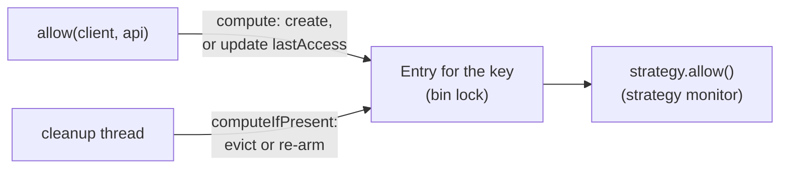
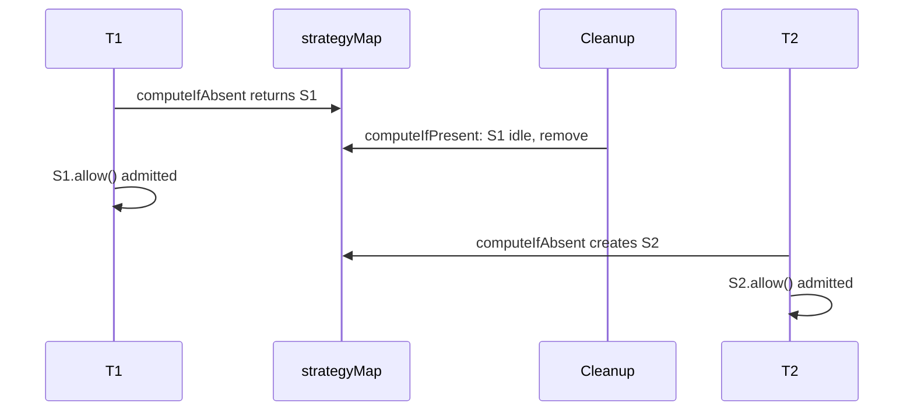

A **rate limiter** answers one question per request: may this client call this API right now? It looks like a fifty-line exercise, and that is the trap. Every bug in the version described here was found by one concrete input or one thread interleaving. None was found by rereading the code.

---

## The problem

The limiter is a library that a service embeds to protect its APIs:

- `allow(clientId, api)` returns whether the request may proceed.
- Limits are configured per (client, API) pair, with a default for pairs that have no explicit config. A config names the algorithm and its parameters: client A might get 100 requests per minute on `/search` with one algorithm, and client B 10 per second on `/upload` with another.
- There are at least two algorithms, and adding a third must not touch existing algorithm code. A **token bucket** holds up to a fixed number of tokens, refills at a steady rate, and spends one token per admitted request. A **sliding window** caps the number of requests in the last window of time.
- Many threads call `allow` at once, for the same and different pairs, and no request may be admitted beyond the configured limit. The sliding window here is the counter variant, which estimates and can let the true count go past the limit, though never to twice it.
- Limits can change at runtime, and memory must not grow without bound as clients appear and go idle.

---

## The design as built

The limiter holds two maps, not one. `clientAndAPIConfig` holds the explicit configs, and `strategyMap` holds the live algorithm state for each pair. They are separate because idle state gets evicted, and an explicit config has to survive that. With one map, the next request after an eviction would silently fall back to the default.

Each algorithm implements one method and guards its own state with `synchronized`:

```java
interface RateLimitStrategy {
    boolean allow(long timeStamp);
}
```

The limiter wraps each strategy in an `Entry` that also carries `lastAccess`, so eviction bookkeeping stays out of the algorithms. A `DelayQueue` and one daemon thread evict pairs that have gone idle.

One call to `allow` does three things:

1. Build the key and read `System.nanoTime()`.
2. Call `strategyMap.compute(key, …)`. If the pair has no entry, create a strategy from its config or the default, and enqueue its first cleanup entry. Otherwise, update `lastAccess` on the existing entry.
3. Outside the map's lock, call `strategy.allow` with a fresh `nanoTime` reading. That takes the strategy's monitor.



So there are two locks on the hot path: the map bin's lock inside `compute`, and the strategy's monitor. Most of this post is about what each one covers and what it doesn't.

---

## Break 1: what `compute` makes atomic

The first draft of the hot path was one line:

```java
return strategyMap.compute(key, (k, existing) -> /* create or reuse */).allow(ts);
```

The instinct is that `compute` is atomic, so this is safe. The line is safe, but not for that reason. The Javadoc does say the whole method invocation is performed atomically<sup><a href="#ref-1">[1]</a></sup>, but that covers the lambda. `.allow(ts)` runs on the returned value after `compute` has returned and the bin lock is released.

One question exposes it: with two threads and one token left, which line stops both of them taking it? Not `compute`, and not `computeIfAbsent`. Only the strategy's own `synchronized` does. Drop it on the belief that `compute` already covers the call, and the limit breaks, as the deliberately broken bucket in the testing section shows.

The two locks have two jobs. The bin lock protects the map's structure, meaning which strategy object belongs to a key. The strategy's monitor protects that strategy's state: its tokens and timestamps. Neither does the other's job. The next version switched to `computeIfAbsent`, which changes nothing about the token race. It only skips the lambda when the key already exists.

The strategy's lock could go. The code carries a TODO to keep the bucket's timestamp and token count in one atomic value and update it with a compare-and-set (CAS) loop. That avoids blocking under heavy contention on one pair. The cost is either packing two numbers into one `long` or allocating a new state object per update, plus a retry loop that is harder to read than a `synchronized` method.

The rule from this section: `compute` makes the lambda atomic, not what you do with its result.

---

## Break 2: the strategy that was evicted while in use

This is the main race in the post. At this point the hot path used `computeIfAbsent` and never touched the entry. Take a limit of 1 request per minute and an idle timeout of a few minutes, on a pair last used just over that timeout ago. By then its strategy, S1, has refilled its one token:

1. T1's `computeIfAbsent` returns strategy S1 and releases the bin lock.
2. The cleanup thread's `computeIfPresent` sees S1 idle and removes it.
3. T1 calls `S1.allow` and is admitted.
4. T2 finds no strategy, creates a fresh S2 with a full bucket, and is admitted.



Two requests are admitted against a limit of 1. Neither strategy is wrong on its own. The limit breaks because two strategies existed for one key.

The tempting fix is to have T1 check the idle deadline itself before using S1. That fails because the deadline can fall exactly between T1's check and the cleanup thread's clock read. It's check-then-act, with the check and the act in different threads under different locks.

The fix is to use `compute` and update `lastAccess` inside the lambda:

```java
var entry = strategyMap.compute(clientAndAPI, (key, existing) -> {
    if (existing == null) {
        var config = clientAndAPIConfig.getOrDefault(key, defaultConfig);
        existing = new Entry(RateLimitStrategyFactory.create(config, timeStamp), timeStamp);
        cleanUpQueue.add(new IdleClientAndAPI(key, timeStamp + idleTimeout));
    } else {
        existing.lastAccess = timeStamp;
    }
    return existing;
});
return entry.strategy.allow(System.nanoTime());
```

Now the update and the eviction are both atomic operations on the same key, so they can't interleave. Either cleanup removes S1 first and T1 creates S2, which leaves one strategy and one admit, or T1 updates first and cleanup sees a fresh `lastAccess` and keeps S1.

A window remains. If T1 is paused, by GC or preemption, for longer than the idle timeout between `compute` returning and `allow` running, cleanup can still evict S1 under it, and one extra request can be admitted. With timeouts in minutes, that's an assumption to write down, not a bug to chase, and the code says so in a comment.

The fix has a cost. `compute` takes the bin lock on every request, even when the entry exists, while `computeIfAbsent` can often return an existing value without locking. Since `allow` already takes the strategy's monitor, the extra cost is mostly contention between pairs whose keys land in the same bin.

Changing a pair's config at runtime has the same shape, and the code accepts it. `setStrategyForClientAndAPI` replaces the pair's entry with a fresh strategy, and a thread that got the old strategy just before the swap still admits against it. That's part of the documented reset: a new config starts with fresh state, so a client can see a sudden new allowance right at the switch.

The rule from this section: a background thread that removes entries from a map the hot path reads needs an answer for "read, then use". The usual answer is to make the use refresh something the remover checks, atomically with the remover's check.

---

## Break 3: bounded memory, unbounded queue

The cleanup design bounded the map but not the queue that drives it. The first version added a `DelayQueue` entry on every `allow` call. A client making 10,000 requests per second with a one-hour idle timeout keeps about 36 million entries alive, all for one key.

The fix is one queue entry per live pair. Creating a pair enqueues its first entry. When the cleanup thread takes an entry and finds the pair still active, it re-arms a new entry at `lastAccess + timeout` instead of evicting:

```java
var idle = cleanUpQueue.take();
long now = System.nanoTime();
long timeout = idleTimeout;

strategyMap.computeIfPresent(idle.clientAndAPI(), (key, entry) -> {
    if (now - entry.lastAccess >= timeout) {
        return null; // idle: evict; an explicit config stays in clientAndAPIConfig
    }
    cleanUpQueue.add(new IdleClientAndAPI(key, entry.lastAccess + timeout));
    return entry;
});
```

Eviction still happens on time. An active pair's entry keeps moving forward, and once the pair goes quiet, the last re-armed entry fires one timeout after its final request. The test for this sends 10,000 requests on one pair and finds exactly one queue entry.

The rule from this section: bound the bookkeeping, not just the data. Keep one queue entry per key and re-arm it, instead of adding one per request.

---

## Which happens-before edge makes it safe

An admin thread can change the default config, a pair's config, or the idle timeout while other threads are calling `allow`. "Memory ordering" doesn't explain why those threads see the change. For each shared field, a specific **happens-before** rule<sup><a href="#ref-2">[2]</a></sup> does, and it's worth naming:

| Field | Writer | Readers | Rule that makes the write visible |
| ----- | ------ | ------- | --------------------------------- |
| `idleTimeout`, `defaultConfig` | admin thread | `allow` threads, cleanup thread | Volatile variable rule: a write to a volatile field happens-before every later read of it |
| `clientAndAPIConfig` entries | admin thread | `allow` threads | `ConcurrentHashMap` publication: what a thread did before putting a value in happens-before what another thread does after reading it back<sup><a href="#ref-3">[3]</a></sup> |
| Config record contents | whoever builds it | everyone with the reference | Final field semantics: records have only final fields, so their contents are safe even if the reference reached a reader without a happens-before edge<sup><a href="#ref-4">[4]</a></sup>. Here the reference also travels through a volatile field or the map, so this is a second guarantee, not the only one |
| `Entry.lastAccess`, a plain `long` | `allow` threads | cleanup thread | `ConcurrentHashMap`'s per-key rule: an update for a key happens-before a later retrieval of that key that sees the update<sup><a href="#ref-1">[1]</a></sup>. Both sides touch `lastAccess` only inside `compute` and `computeIfPresent` lambdas for the same key |
| Strategy state | `allow` threads | `allow` threads | Monitor lock rule: `synchronized` on the strategy |

The volatile row in one line: a volatile write is a release, and a volatile read is an acquire. If the read sees the write, everything the writer did before the write is visible after the read, by program order plus transitivity.

Without `volatile`, nothing guarantees the cleanup thread ever sees a new timeout. In a tight loop, the JIT can keep such a value in a register or hoist the read out of the loop entirely. Here the blocking `take()` makes that unlikely in practice, but unlikely is not a guarantee.

The rules you'll use most, by name: program order, monitor lock, volatile variable, thread start, thread join, and transitivity, plus final field semantics.

Two behaviours follow from this design and are worth stating. Pairs already running keep the old default until they are evicted, and only new or re-created pairs see the new one. Changing a pair's own config resets its state, as Break 2 described.

The rule from this section: for every shared field, name the happens-before rule.

---

## `nanoTime` wraps: subtract, never compare

`System.nanoTime` has an arbitrary origin, so readings can be negative and can wrap past `Long.MAX_VALUE`. Its Javadoc<sup><a href="#ref-5">[5]</a></sup> spells out the consequence: check a timeout as `System.nanoTime() - startTime >= timeoutNanos`, not as `System.nanoTime() >= startTime + timeoutNanos`, because the addition can overflow. Subtraction still gives the right difference across a wrap, for gaps up to about 292 years.

Both strategies already computed elapsed time by subtraction. Two places in the limiter didn't, and were fixed:

- The idle check was `lastAccess + idleTimeout < now`, the exact form the Javadoc warns against. It's now `now - entry.lastAccess >= timeout`.
- The queue's `compareTo` used `Long.compare` on deadlines, which sorts a deadline just after the wrap ahead of one just before it. It now compares the sign of `this.deadline() - other.deadline()`.

In practice the wrap almost never happens, since on Linux HotSpot's readings count from around boot. The fix costs nothing, and it relies on the documented contract instead of on that.

The rule from this section: subtract `nanoTime` readings; never compare them.

---

## Adding a third algorithm, and why self-registration fails

The requirement says adding an algorithm must not touch existing algorithm code. The code uses a factory with a `switch` over config types. That meets the requirement as written, since the factory isn't algorithm code, but adding an algorithm still means editing an existing file.

| Approach | Where it fails | When you find out |
| -------- | -------------- | ----------------- |
| Factory `switch` over config types (the current code) | Every new algorithm edits the factory | First request for a pair using it, when a missed case hits `default` |
| Reflection, with the class name derived from the config's name | A class named off-convention, or a different constructor | First request for a pair using it |
| Each strategy registers itself in a static block | The static block never runs | First request for a pair using it |
| `ServiceLoader` with a provider per algorithm | Provider not declared in `META-INF/services` or `module-info` | Startup, if all providers are loaded then |
| Config creates its own strategy: `config.newStrategy(ts)` | Config is no longer pure data | Compile time |

The `switch` could fail at compile time instead. Make `RateLimitConfig` a sealed interface and drop the `default` branch, and the compiler checks that every case is covered. But then adding an algorithm also edits the `permits` list.

The surprise is in the self-registration row. Classes are initialized lazily, on first active use, such as creating an instance, calling a static method, or using a static field that isn't a constant<sup><a href="#ref-6">[6]</a></sup>. They are not all initialized before `main`. Say the third algorithm is a leaky bucket. If nothing references `LeakyBucketStrategy`, its registering static block hasn't run when the factory looks up `LeakyBucketConfig`, and the lookup fails. My first instinct was that static blocks all run at startup. One config set at runtime, with no other reference to the class, disproved it.

`ServiceLoader` has its own constraint. A provider on the class path needs a public no-argument constructor, and one in a named module can use a public static `provider()` method instead<sup><a href="#ref-7">[7]</a></sup>. Either way it takes no arguments, while a strategy takes a config and a timestamp. So each algorithm registers a small provider, holding its config type and a `create(config, ts)` method, not the strategy itself.

The simplest design that needs no edits anywhere is `newStrategy` on the config. There's no registry and no reflection, the compiler checks every pairing, and class loading can't bite, because whoever built the config already referenced its class. It stops working when configs arrive as data, such as JSON from an admin API with a type field. Then something still has to map a type string to a class, and the registry comes back.

The rule from this section: know when your registration code runs. A static block runs on first use of its class, not at startup.

---

## Testing: control time, release threads together, watch it fail

The suite has 23 checks. Each expected value is worked out from the configured limit, not read off the output.

Strategies take the timestamp as a parameter, so every algorithm test drives time by hand and is fully deterministic, down to a bucket created just below `Long.MAX_VALUE`. The limiter itself reads `nanoTime`, so its tests use a rate of one token per minute, where nothing can refill during the test, and real sleeps only for eviction.

Threads are released together by a `CountDownLatch` start gate. Without it, threads start one at a time and the race window rarely opens:

```java
var ready = new CountDownLatch(threads);
var start = new CountDownLatch(1);
// each worker: ready.countDown(); start.await(); then call allow() in a loop
ready.await();      // every worker is parked at the gate
start.countDown();  // release them all at once
```

With the gate, 16 threads making 1,000 calls each on one pair admit exactly 100 under both algorithms. Spread over 8 pairs, they admit exactly 800.

A concurrency test only counts once you've seen it fail, so the suite includes a deliberately broken bucket with no lock, run under the same harness. On a 2-core machine, 20 rounds caught it in only 1 run out of 3. At 200 rounds it failed every time, admitting 111 to 122 against a limit of 100. One green run of a concurrency test tells you very little. The repo's harness runs 20 rounds, so raise it if your machine doesn't show the failure.

For races at the level of the Java memory model, such as a missing `volatile`, the right tool is jcstress<sup><a href="#ref-8">[8]</a></sup>. It's more than this suite needs, because the races here are about what a lock covers, and a start gate plus many rounds is enough to show them.

One race has no test. The eviction race from Break 2 needs the cleanup thread to land in a window a few nanoseconds wide, so its fix is argued from the locking, not demonstrated.

The rule from this section: a concurrency test you haven't seen fail proves nothing.

---

## What I took away

One rule per section:

1. `compute` makes the lambda atomic, not what you do with its result.
2. A background remover needs an answer for "read, then use" on the hot path: make the use refresh what the remover checks, atomically with its check.
3. Bound the bookkeeping, not just the data: one queue entry per key, re-armed.
4. For every shared field, name the happens-before rule.
5. Subtract `nanoTime` readings; never compare them.
6. Know when registration code runs: a static block runs on first use of its class.
7. A concurrency test you haven't seen fail proves nothing.

The full limiter and its tests are on GitHub<sup><a href="#ref-9">[9]</a></sup>. It is a single Java file and needs Java 25 or later.

---

## References

<span id="ref-1">[1]</span> Oracle, *Java SE 25 API: ConcurrentHashMap*. [https://docs.oracle.com/en/java/javase/25/docs/api/java.base/java/util/concurrent/ConcurrentHashMap.html](https://docs.oracle.com/en/java/javase/25/docs/api/java.base/java/util/concurrent/ConcurrentHashMap.html)

<span id="ref-2">[2]</span> Oracle, *The Java Language Specification, Java SE 25 Edition, §17.4.5 Happens-before Order*. [https://docs.oracle.com/javase/specs/jls/se25/html/jls-17.html#jls-17.4.5](https://docs.oracle.com/javase/specs/jls/se25/html/jls-17.html#jls-17.4.5)

<span id="ref-3">[3]</span> Oracle, *java.util.concurrent package summary: Memory Consistency Properties*. [https://docs.oracle.com/en/java/javase/25/docs/api/java.base/java/util/concurrent/package-summary.html#MemoryVisibility](https://docs.oracle.com/en/java/javase/25/docs/api/java.base/java/util/concurrent/package-summary.html#MemoryVisibility)

<span id="ref-4">[4]</span> Oracle, *The Java Language Specification, Java SE 25 Edition, §17.5 final Field Semantics*. [https://docs.oracle.com/javase/specs/jls/se25/html/jls-17.html#jls-17.5](https://docs.oracle.com/javase/specs/jls/se25/html/jls-17.html#jls-17.5)

<span id="ref-5">[5]</span> Oracle, *Java SE 25 API: System.nanoTime()*. [https://docs.oracle.com/en/java/javase/25/docs/api/java.base/java/lang/System.html#nanoTime()](https://docs.oracle.com/en/java/javase/25/docs/api/java.base/java/lang/System.html#nanoTime())

<span id="ref-6">[6]</span> Oracle, *The Java Language Specification, Java SE 25 Edition, §12.4.1 When Initialization Occurs*. [https://docs.oracle.com/javase/specs/jls/se25/html/jls-12.html#jls-12.4.1](https://docs.oracle.com/javase/specs/jls/se25/html/jls-12.html#jls-12.4.1)

<span id="ref-7">[7]</span> Oracle, *Java SE 25 API: ServiceLoader*. [https://docs.oracle.com/en/java/javase/25/docs/api/java.base/java/util/ServiceLoader.html](https://docs.oracle.com/en/java/javase/25/docs/api/java.base/java/util/ServiceLoader.html)

<span id="ref-8">[8]</span> OpenJDK, *jcstress (Java Concurrency Stress)*. [https://github.com/openjdk/jcstress](https://github.com/openjdk/jcstress)

<span id="ref-9">[9]</span> Saksham Gupta, *lld-deep-dives: rate-limiter*. [https://github.com/0mega28/lld-deep-dives/tree/main/rate-limiter](https://github.com/0mega28/lld-deep-dives/tree/main/rate-limiter)
